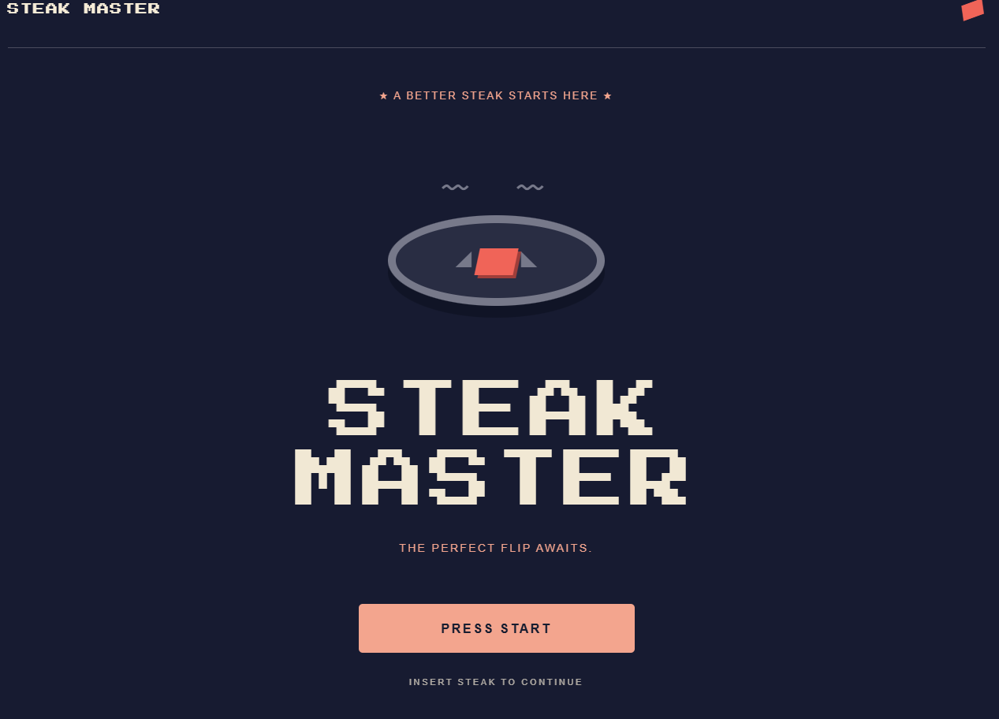
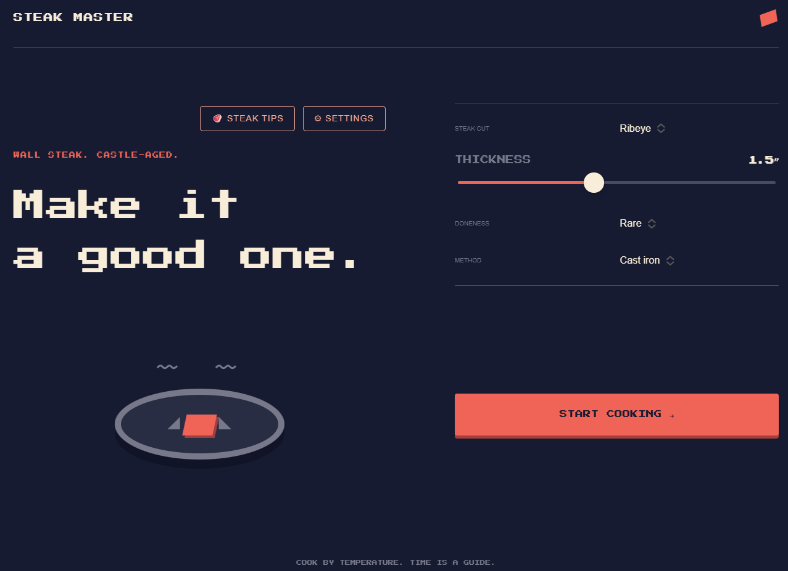

# 🥩 Steak Master

### A retro-inspired steak cooking companion.

Steak Master is a mobile-friendly cooking application that helps you cook a great steak using guided timers, flip reminders, and temperature checks.

Inspired by classic 8-bit video games, Steak Master combines nostalgic visuals with a simple, practical cooking experience.

## Features

- Retro arcade-inspired interface
- Interactive title screen with PRESS START
- Selection of nine steak cuts
- Adjustable steak thickness
- Preferred doneness selection
- Cooking method selection
- Guided cooking timers
- Retro sound alerts
- Interactive flip confirmation
- Internal temperature verification
- Fahrenheit and Celsius support
- USDA food-safety guidance
- Customizable cooking preferences
- Local session persistence
- Mobile-friendly design


## Screenshots

### Title Screen
The retro arcade-inspired welcome screen.



### Steak Configuration
Choose your steak cut, thickness, doneness, and cooking method.



### Flip Prompt
A classic arcade-style checkpoint during cooking.


---


## Technology Stack

**Frontend**
- React
- TypeScript
- Ionic
- CSS
- Vite

**Backend**
- C#
- ASP.NET Core Web API

**Development Tools**
- Visual Studio Code
- Git and GitHub

## Getting Started

### Prerequisites

- Node.js and npm
- .NET SDK
- Git

### 1. Clone the repository

```bash
git clone https://github.com/YOUR-USERNAME/steak-master.git
cd steak-master
```

Replace `YOUR-USERNAME` with your GitHub username.

### 2. Start the backend

Open a terminal:

```bash
cd backend/SteakMaster.Api
dotnet restore
dotnet run
```

The API will start on its configured local address.

### 3. Start the frontend

Open a second terminal from the project root:

```bash
cd mobile
npm install
npm run dev
```

Open the local URL displayed by Vite.

## How It Works

1. **Choose your steak:** Select the cut, thickness, cooking method, and desired doneness.
2. **Start cooking:** Follow the guided countdown for the first side.
3. **Flip:** When prompted, turn the steak and confirm the flip.
4. **Check temperature:** Use an instant-read thermometer to verify the internal temperature.
5. **Finish:** Follow the remaining cooking and resting guidance.

## Design Philosophy

Steak Master takes inspiration from classic Japanese retro video games.

The interface uses a limited color palette, pixel-inspired artwork, simple typography, and arcade-style prompts.

The goal is to make cooking feel approachable, engaging, and distraction-free.

## Current Status

**Version 1.0 — Initial GitHub release**

Steak Master is a working development project with a functional cooking workflow.

The application runs in a browser and has been tested on an iPhone using Safari.

### Potential Future Improvements

- Installable Progressive Web App (PWA)
- Native iOS and Android builds
- Device vibration and native notifications
- Automated testing
- Expanded cooking recommendations

## Food Safety

Cooking times are estimates and should not be used as the sole indicator of doneness.

Always use a reliable instant-read thermometer to verify internal temperature.

USDA guidance recommends cooking whole cuts of beef to a minimum internal temperature of 145°F (63°C), followed by at least a three-minute rest.

## License

No open-source license has been selected yet.

---

Built with React, TypeScript, and C#.
